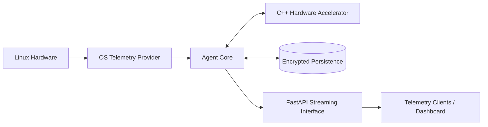

<div align="center">

# Golden-Agent

**A self-healing cybernetic engine for high-stakes edge execution.**

Sub-millisecond local orchestration. Smart loop throttling. Zero cloud dependency.


</div>

---

## Table of Contents

1. [Overview](#overview)
2. [Core Pillars](#core-pillars)
3. [Architecture](#architecture)
4. [Tech Stack](#tech-stack)
5. [Repository Structure](#repository-structure)
6. [Requirements](#requirements)
7. [Installation](#installation)
8. [Quick Start](#quick-start)
9. [Docker](#docker)
10. [Testing](#testing)
11. [Security and Key Management](#security-and-key-management)
12. [Documentation](#documentation)
13. [Contributing](#contributing)
14. [License](#license)

---

## Overview

Golden-Agent is a self-healing agent runtime designed for environments where
latency, privacy, and resilience matter more than convenience. It runs entirely
on local hardware, monitors its own host through live telemetry, and
dynamically throttles its execution loops so that it stays responsive under
load.

It is built for deep-tech teams, defense contractors, and autonomous-systems
developers who need private, bare-metal agency without routing data through the
cloud.

---

## Core Pillars

| Pillar | Description |
|--------|-------------|
| **Dynamic Telemetry and Loop Throttling** | Reads live host metrics and adjusts loop timing so the agent stays stable and responsive under changing load. |
| **C++ Acceleration Bridge** | Performance-critical paths are offloaded to a native C++17 extension. |
| **FastAPI Streaming Interface** | Real-time telemetry and state are exposed over an async FastAPI/Uvicorn service. |
| **Resilient Encrypted Persistence** | State and model weights are stored encrypted, with support for key rotation. |
| **Privileged Edge Execution** | Runs directly on bare-metal Linux with the hardware access it needs, and no cloud round-trips. |

---

## Architecture



The agent core consumes host telemetry, uses it to throttle its own loops,
delegates heavy computation to the native accelerator, persists state to an
encrypted store, and streams live status to connected clients.

---

## Tech Stack

- **Language:** Python 3.10+
- **Web / Streaming:** FastAPI, Uvicorn
- **Native Extension:** C++17 (`kryptic_hardware_accelerator.cpp`), built with CMake
- **Monitoring:** Custom Linux hardware telemetry
- **Testing:** pytest
- **Packaging:** Docker, Docker Compose, shell release scripts

---

## Repository Structure

```text
Golden-Agent/
├── .github/                          # GitHub configuration and workflows
├── commercial/                       # Production launch assets
├── scripts/                          # Automation and helper scripts
│
├── unified_conscious_agent.py        # Local node entry point
├── kryptic_agent_core.py             # Core agent logic
├── robotic_sentience_core.py         # Agent state and cognition core
├── robotic_database_core.py          # Persistence layer
├── workspace_cognitive_bridge.py     # Bridge between workspace and agent core
├── os_telemetry_provider.py          # Linux host telemetry
├── stream_client_telemetry.py        # Streaming telemetry client
├── gui_dashboard.py                  # Dashboard interface
│
├── kryptic_hardware_accelerator.cpp  # C++17 native acceleration
├── kryptic_hardware_launch.py        # Hardware-mode launcher
├── kryptic_edge_launch.py            #
