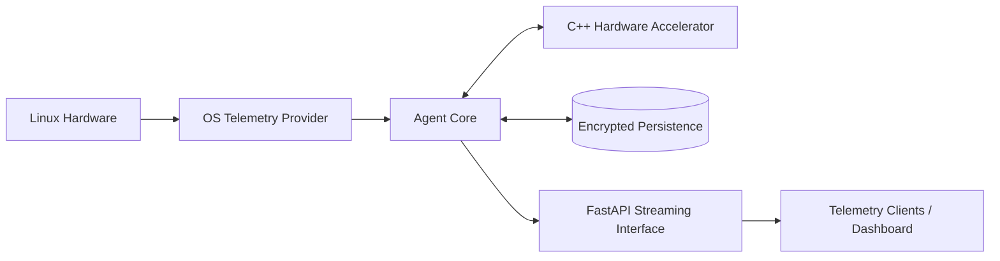

<div align="center">

# Golden-Agent

**A self-healing cybernetic engine for high-stakes edge execution.**

Sub-millisecond local orchestration. Smart loop throttling. Zero cloud dependency.


</div>

---

## Table of Contents

1. [Overview](#overview)
2. [Core Pillars](#core-pillars)
3. [Architecture](#architecture)
4. [Repository Structure](#repository-structure)
5. [Requirements](#requirements)
6. [Installation](#installation)
7. [Quick Start](#quick-start)
8. [Docker](#docker)
9. [Testing](#testing)
10. [Benchmarks](#benchmarks)
11. [Security](#security)
12. [Documentation](#documentation)
13. [Contributing](#contributing)
14. [License](#license)

---

## Overview

Golden-Agent is a self-healing agent runtime for environments where latency,
privacy, and resilience matter more than convenience. It runs entirely on local
hardware, monitors its own host through live telemetry, and dynamically
throttles its execution loops so it stays responsive under load.

It is built for deep-tech teams, defense contractors, and autonomous-systems
developers who need private, bare-metal agency without routing data through
the cloud.

---

## Core Pillars

| Pillar | Description |
|--------|-------------|
| **Dynamic Telemetry and Loop Throttling** | Reads live host metrics and adjusts loop timing to stay stable under changing load. |
| **C++ Acceleration Bridge** | Performance-critical paths run in a native C++17 extension. |
| **FastAPI Streaming Interface** | Real-time telemetry and state over an async FastAPI/Uvicorn service. |
| **Resilient Encrypted Persistence** | Encrypted state and model weights with key rotation support. |
| **Privileged Edge Execution** | Runs on bare-metal Linux with direct hardware access and no cloud round-trips. |

---

## Architecture



---

## Repository Structure

```text
Golden-Agent/
├── .github/workflows/ci.yml          # CI: tests + benchmark smoke test
├── benchmarks/                       # Reproducible latency/jitter harness
│   ├── latency_bench.py
│   ├── targets.py                    # Wire to one agent loop iteration
│   └── results/                      # Generated reports (git-ignored)
├── docs/                             # Documentation and grant materials
├── grants/                           # Grant and business tooling
├── commercial/                       # Production launch assets
├── scripts/                          # Automation and helper scripts
│
├── unified_conscious_agent.py        # Local node entry point
├── kryptic_agent_core.py             # Core agent logic
├── robotic_sentience_core.py         # Agent state and cognition core
├── robotic_database_core.py          # Persistence layer
├── workspace_cognitive_bridge.py     # Workspace/agent bridge
├── os_telemetry_provider.py          # Linux host telemetry
├── stream_client_telemetry.py        # Streaming telemetry client
├── gui_dashboard.py                  # Dashboard interface
├── kryptic_hardware_accelerator.cpp  # C++17 native acceleration
├── kryptic_hardware_launch.py        # Hardware-mode launcher
├── kryptic_edge_launch.py            # Edge/production launcher
├── encrypt_weights.py                # Encrypts model weights at rest
├── key_rotation_manager.py           # Encryption key rotation
│
├── test_*.py                         # Test suite
├── CMakeLists.txt
├── Dockerfile
├── docker-compose.yml
├── requirements.txt
├── AGENTS.md
├── SECURITY.md
└── LICENSE                           # Apache-2.0
```

---

## Requirements

- Native **Linux** (bare-metal recommended)
- **Python 3.10** or newer
- **C++17** compiler (GCC or Clang) and **CMake**
- `pip` and `git`
- Optional: Docker and Docker Compose

---

## Installation

```bash
git clone https://github.com/KrypticKode007/Golden-Agent.git

cd Golden-Agent

python3 -m venv .venv

source .venv/bin/activate

chmod +x scripts/*.sh

./scripts/sync_testing_suite.sh

pip install -r requirements.txt
```

---

## Quick Start

```bash
# Launch a local node
python unified_conscious_agent.py

# Production launch
python commercial/kryptic_edge_launch.py

# Hardware mode
python kryptic_hardware_launch.py
```

---

## Docker

```bash
docker compose up --build
```

Containers have limited access to host hardware telemetry. For full
bare-metal behavior, run natively.

---

## Testing

```bash
pytest
```

| Test File | Focus |
|-----------|-------|
| `test_telemetry_edge.py` | Telemetry on the edge |
| `test_realtime_stream.py` | Real-time streaming |
| `test_secure_pipeline.py` | Secure/encrypted pipeline |
| `test_network_hotswap.py` | Network hot-swapping |
| `test_grant_compilation.py` | Grant document compilation |
| `test_grant_milestones.py` | Grant milestone validation |

CI runs the suite on Python 3.10, 3.11, and 3.12 for every push and pull request.

---

## Benchmarks

Latency and jitter are measured with a reproducible harness that reports
median, p95, p99, p99.9, and max, both idle and under synthetic CPU load.

```bash
python benchmarks/latency_bench.py \
    --target benchmarks.targets:tick \
    --iterations 100000 \
    --warmup 5000 \
    --load-workers 4
```

See [`benchmarks/README.md`](benchmarks/README.md) for methodology and
[`docs/quantified_performance_metrics.md`](docs/quantified_performance_metrics.md)
for published results.

---

## Security

Golden-Agent is designed to run with elevated, hardware-level access.

- Run on dedicated or tightly controlled hosts.
- Encrypt weights at rest with `encrypt_weights.py`.
- Rotate keys regularly with `key_rotation_manager.py`.
- Never commit secrets.
- Bind the streaming interface to trusted interfaces only.

Report vulnerabilities privately; see [`SECURITY.md`](SECURITY.md).

---

## Documentation

See the [documentation index](docs/README.md), including the
[capabilities statement](docs/capabilities_statement.md) and the
[grant roadmap](docs/GRANT_ROADMAP.md).

---

## Contributing

Issues and pull requests are currently limited to collaborators. For
questions, use the repository's
[Discussions](https://github.com/KrypticKode007/Golden-Agent/discussions).

---

## License

Licensed under the **Apache License 2.0**. See [`LICENSE`](LICENSE).

---

<div align="center">

Built by [KrypticKode007](https://github.com/KrypticKode007)

</div>
