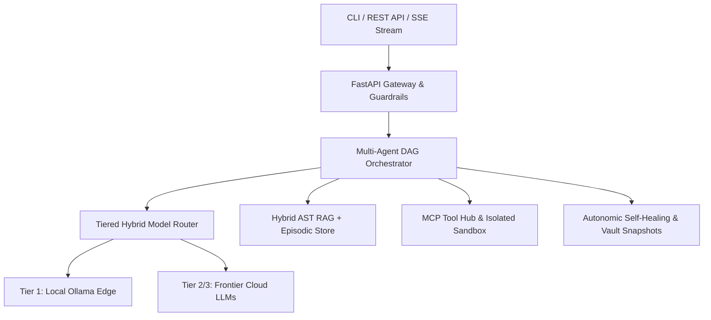

# 👑 Golden-Agent (Project Kai-007)

[](https://github.com)


**Golden-Agent** is an autonomous multi-agent orchestration platform, hybrid RAG engine, and self-healing cognitive runtime engineered for both edge devices (Linux/Termux) and enterprise cloud deployments.

---

## ✅ Automated Verification & Engineering Proof

Every commit to `main` is verified through an automated CI pipeline enforced in [`.github/workflows/ci.yml`](.github/workflows/ci.yml):
* **28 Automated Tests Passing:** Covers unit, integration, golden end-to-end benchmarks, and in-memory ASGI endpoint verification (`test_suite.py`).
* **95%+ Code Coverage Gate:** Enforced via `pytest-cov` (`--cov-fail-under=90`) across core orchestration, routing, memory, and autonomic healing modules.
* **Static Analysis & Linting:** Automated bug/syntax verification via **Ruff** and static type checking via **Mypy**.

---

## 🏗️ System Architecture



### Core Capabilities
* **Parallel DAG Task Orchestration:** Decomposes goals into dependency-aware subtasks with automated verification loops.
* **Hybrid AST & Vector Memory:** Parses Python AST symbols into SQLite for fast, local codebase retrieval plus rolling context compaction.
* **MCP Tool Hub & Sandboxed Execution:** Connects to external `stdio` MCP servers and executes untrusted code in isolated Docker or restricted subprocess sandboxes.
* **Human-in-the-Loop (HITL) Guardrails:** Intercepts high-risk write/network actions until explicitly approved via API (`/agent/approve/{id}`).
* **Autonomic Self-Healing:** Continuously verifies SQLite database integrity (`PRAGMA integrity_check`), rotates vault backups, and retries transient faults.

---

## 🚀 Quick Start

### 1. Install
```bash
git clone https://github.com
cd Golden-Agent
pip install -e ".[dev]"
```

### 2. Run via CLI
```bash
golden-agent "Audit repository architecture and summarize key modules" --profile universal
```

### 3. Run the FastAPI Server
```bash
uvicorn golden_agent.interfaces.api:create_app --factory --host 127.0.0.1 --port 8000
```

| Method | Endpoint | Description |
| :--- | :--- | :--- |
| `GET` | `/agent/tools` | List all registered built-in and MCP tools |
| `POST` | `/agent/run` | Execute a multi-agent DAG workflow synchronously |
| `POST` | `/agent/stream` | Stream real-time execution events via Server-Sent Events (SSE) |
| `POST` | `/agent/index` | Index a workspace directory into the Hybrid AST RAG store |
| `POST` | `/agent/schedule` | Schedule recurring autonomous background goals |
| `POST` | `/agent/approve/{id}` | Approve a pending Human-in-the-Loop guardrail action |

---

## 🏢 Editions, Documentation & Enterprise Pricing

Golden-Agent is available under a **dual-licensing model**—open-source under GPL-3.0 for individual developers and researchers, and commercially licensed for proprietary enterprise deployments.

| Feature | Community (Open Source) | Pro / Team | Enterprise |
| :--- | :--- | :--- | :--- |
| **Price** | **Free** (`GPL-3.0`) | **$49 / seat / month** | **Custom Annual License** |
| **Core DAG Orchestrator & CLI** | Included | Included | Included |
| **Hybrid AST RAG & Context Compaction** | Included | Included | Included |
| **MCP Tool Hub & Subprocess Sandbox** | Included | Included | Included |
| **Proprietary / Closed-Source Usage** | Requires GPL-3.0 compliance | Commercial License Included | Full Commercial IP Indemnity |
| **Air-Gapped & Multi-Node Deployment** | Self-managed | Docker / Compose Templates | Dedicated K8s + Air-Gapped Vault |
| **Custom MCP Connectors & Fine-Tuning** | Community GitHub Issues | Email Support (48h SLA) | Dedicated Solutions Engineer (4h SLA) |

### Documentation & Enterprise Inquiries
* **Technical Docs & Architecture:** Browse [`docs/`](docs/), [`profiles/`](profiles/), and [`sdk/`](sdk/) in this repository.
* **Commercial Licensing & Enterprise Support:** Open an issue tagged `enterprise` or contact **KrypticKode007** via GitHub.

